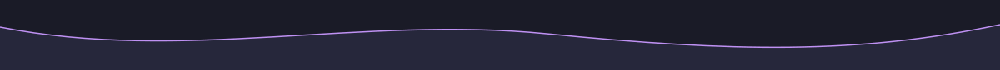

<p align="center">
  
</p>

<p align="center">
  
</p>

<br/>

<p align="center">
  <a href="https://www.linkedin.com/in/hassana-dev/">
    
  </a>
  &nbsp;
  <a href="mailto:hassanabbas05674@gmail.com">
    
  </a>
  &nbsp;
  <a href="https://github.com/HassanAbbas10?tab=followers">
    
  </a>
  &nbsp;
  
</p>

<br/>

---

## `$ whoami`

```ts
const hassan = {
  role:      "Full Stack Engineer",
  stack:     ["React", "Next.js", "TypeScript", "Node.js", "PostgreSQL", "Tailwind"],
  building:  ["Dashboards", "SaaS Products", "Internal Tools", "API-driven Apps"],
  learning:  ["DSA", "System Design", "Architecture Patterns", "UX Engineering"],
  values:    ["Clean UI", "Readable Code", "Developer Experience", "Calm Software"],
  contact:   "hassanabbas05674@gmail.com",
};
```

> Software that feels calm on the surface and solid underneath —  
> clean interfaces, clear API flow, and code that still makes sense six months later.

---

## Stack

<table>
  <tr>
    <td valign="top" width="50%">
      <h4>Frontend</h4>
      <p>
        
        
        
        
        
        
        
        
        
        
      </p>
    </td>
    <td valign="top" width="50%">
      <h4>Backend &amp; Data</h4>
      <p>
        
        
        
        
        
        
        
        
        
      </p>
    </td>
  </tr>
  <tr>
    <td valign="top">
      <h4>DevOps &amp; Tooling</h4>
      <p>
        
        
        
        
        
        
        
        
      </p>
    </td>
    <td valign="top">
      <h4>UI Libraries</h4>
      <p>
        
        
        
        
        
      </p>
    </td>
  </tr>
</table>

---

## How I Build

<table>
  <tr>
    <td width="25%" align="center">
      <h3>01 — Understand</h3>
      <p>Start with real constraints. Map the user flow, identify friction, and define what "done" actually means.</p>
    </td>
    <td width="25%" align="center">
      <h3>02 — Structure</h3>
      <p>Break the work into clear UI layers, data contracts, and backend responsibilities before touching code.</p>
    </td>
    <td width="25%" align="center">
      <h3>03 — Build</h3>
      <p>Maintainable, practical code. No over-engineering. Move fast with strong fundamentals.</p>
    </td>
    <td width="25%" align="center">
      <h3>04 — Refine</h3>
      <p>Polish interactions. Clean rough edges. Improve readability. Raise the bar — then ship again.</p>
    </td>
  </tr>
</table>

---

## Currently

<p align="center">
  
</p>

<p align="center"><sub><i>Code, coffee, calm focus — one more iteration.</i></sub></p>

- 🔨 **Building** [BundleBack](https://bundle-back.vercel.app/) — tracking costs, sales, and cash recovery for resale lots
- 📐 **Leveling up** in DSA, system design, and frontend architecture
- 🎯 **Focused on** UI polish, DX, and building software that scales cleanly
- 🤝 **Open to** software engineering roles, open-source collab, and product-focused side projects

---

## Currently Reading

<table>
  <tr>
    <td valign="middle">
      <h4>📖 &nbsp;Designing Data-Intensive Applications</h4>
      <p><sub>Martin Kleppmann &nbsp;·&nbsp; O'Reilly Media</sub></p>
      <p>Deep-diving into how modern data systems are built — replication, partitioning, transactions, consistency, and the tradeoffs behind every architectural decision.</p>
      <p>
        
        
        
      </p>
    </td>
  </tr>
</table>

---

## Best Fit

```
✦  Admin dashboards and internal tools
✦  Modern SaaS interfaces with high UX bar
✦  API-driven apps with clean data flow
✦  React-heavy frontends with TypeScript
✦  Full stack products from schema to UI
```

---

## GitHub

<p align="center">
  
  
</p>

<p align="center">
  
</p>

<details>
  <summary>Contribution history</summary>
  <br />
  <p align="center">
    
  </p>
</details>

---

## Connect

<p align="center">
  <a href="https://www.linkedin.com/in/hassana-dev/">
    
  </a>
  &nbsp;&nbsp;
  <a href="mailto:hassanabbas05674@gmail.com">
    
  </a>
  &nbsp;&nbsp;
  <a href="https://github.com/HassanAbbas10?tab=repositories">
    
  </a>
</p>

<br/>

<p align="center">
  <sub><i>Building calm, useful software — one clean commit at a time.</i></sub>
</p>

<p align="center">
  
</p>
