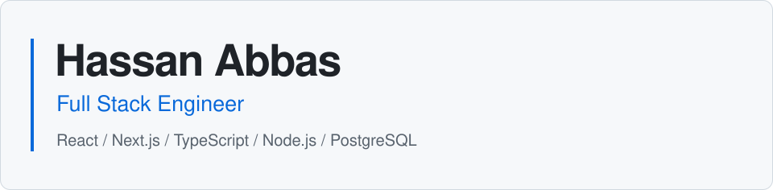

<picture>
  <source media="(prefers-color-scheme: dark)" srcset="./assets/header.svg" />
  
</picture>

[LinkedIn](https://www.linkedin.com/in/hassana-dev/) &nbsp; / &nbsp; [Email](mailto:hassanabbas05674@gmail.com) &nbsp; / &nbsp; [Repositories](https://github.com/HassanAbbas10?tab=repositories)

I build dashboards, SaaS products, and internal tools with React, TypeScript,
Node.js, and PostgreSQL. I care about clear interfaces, reliable APIs, and
code that's easy to work with.

## Building

### [BundleBack](https://bundle-back.vercel.app/)

A tool for tracking costs, sales, and cash recovery across resale lots.
Built around a practical question: how much of a lot's original cost has been
recovered, and what's still left to sell?

[View BundleBack](https://bundle-back.vercel.app/)

## Technologies

**Frontend**  
React, Next.js, TypeScript, JavaScript, Tailwind CSS, HTML, CSS,
Redux, React Query, Vite

**Backend & data**  
Node.js, Express, PostgreSQL, MongoDB, Supabase, Prisma, Firebase,
Python, JWT

**Tools & delivery**  
Git, GitHub, GitHub Actions, Docker, AWS, Postman, Vercel, Sentry

**UI libraries**  
MUI, DaisyUI, React Hook Form, Chart.js, React Router

## How I work

- Understand the workflow and constraints before choosing an approach.
- Keep UI components, API contracts, and data responsibilities clear.
- Build in small iterations and refine the interactions along the way.
- Write readable code that the next developer can follow.

## Currently

- Studying data structures, algorithms, system design, and frontend architecture.
- Reading **Designing Data-Intensive Applications** by Martin Kleppmann,
  with a focus on replication, transactions, and consistency.
- Open to software engineering roles, open-source collaboration,
  and product-focused projects.

## GitHub activity

  
Stats, languages, and contribution history

   

  <picture>
    <source media="(prefers-color-scheme: dark)" srcset="https://github-profile-summary-cards.vercel.app/api/cards/stats?username=HassanAbbas10&amp;theme=github_dark" />
    
  </picture>
  <picture>
    <source media="(prefers-color-scheme: dark)" srcset="https://github-profile-summary-cards.vercel.app/api/cards/repos-per-language?username=HassanAbbas10&amp;theme=github_dark" />
    
  </picture>
  <picture>
    <source media="(prefers-color-scheme: dark)" srcset="https://github-profile-summary-cards.vercel.app/api/cards/profile-details?username=HassanAbbas10&amp;theme=github_dark" />
    
  </picture>

[Browse my repositories](https://github.com/HassanAbbas10?tab=repositories)

---

Have a role or project in mind? [Get in touch](mailto:hassanabbas05674@gmail.com).
